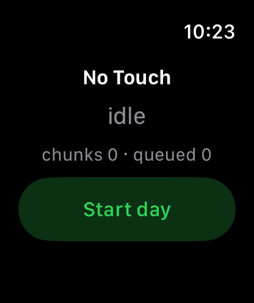
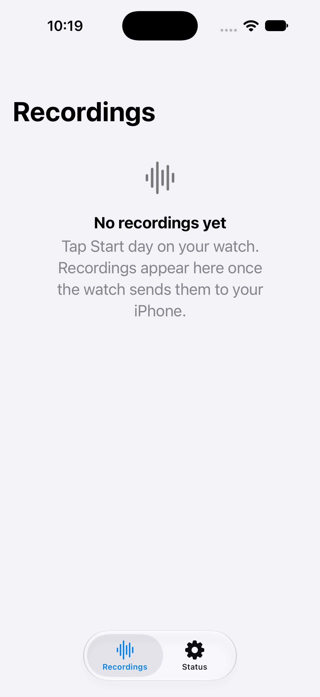
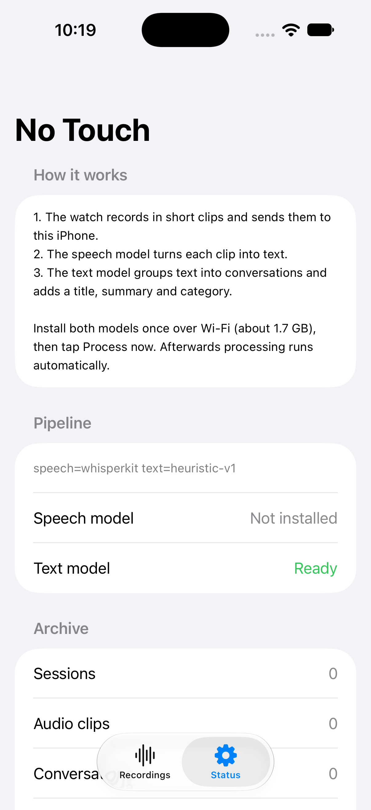

<div align="center">


# No Touch

**Your day, remembered — without ever reaching for your phone.**

[](https://developer.apple.com/ios/)
[](https://developer.apple.com/watchos/)
[](https://swift.org)
[](docs/spec.md)
[](LICENSE)

</div>

No Touch is a native Apple Watch + iPhone recorder built around a single idea: tap once in the morning, and let your Watch quietly capture the conversations that matter. Every recording is transcribed, organized, and summarized **entirely on your own devices** — no cloud, no accounts, no audio ever leaving your hands.

Built for real life in the Gulf: first-class **Saudi/Gulf Arabic**, seamless Arabic–English code-switching, and a daily timeline you can actually search.

<div align="center">
  
  &nbsp;&nbsp;
  
  &nbsp;&nbsp;
  
</div>

---

## Why No Touch

- **One tap, all day.** Start a session on your Watch once. It keeps listening through quiet periods, wrist-down moments, and ordinary Watch use — pausing only when *you* say so.
- **Nothing gets lost.** Audio is chunked into recoverable segments on the Watch and queued for your iPhone. Phone out of range? Chunks wait patiently and transfer when you reconnect — deduplicated, in order, and never deleted from the Watch until your iPhone has them safely.
- **Truthful status.** Recording, transfer, and analysis are separate indicators — never one misleading spinner. Pause instantly for private moments, see gaps honestly, and always know whether the mic is live.
- **On-device intelligence.** WhisperKit transcribes your speech locally; an MLX-powered language model (Qwen3 family) turns transcripts into organized conversations — titles, summaries, categories, decisions, and action items — with zero network calls.
- **Made for Arabic.** Direct Saudi/Gulf Arabic transcription, readable mixed-language rendering, Arabic titles and summaries, and full-text search across both Arabic and English.
- **Verifiable, not hallucinated.** Every generated statement links back to its source transcript passages and playable audio timestamps. Your edits are durable and never overwritten by reprocessing.
- **Alive on your iPhone.** A Live Activity and Dynamic Island show recording state, clips received, and last-heard-from — at a glance, on the Lock Screen.

## How it works

```
┌─────────────────┐         ┌──────────────────────────────┐
│   Apple Watch   │         │            iPhone            │
│                 │         │                              │
│  One-tap start  │         │   WhisperKit transcription   │
│  Chunked audio  │──WC──▶  │   Conversation grouping      │
│  capture w/     │  file   │   MLX/Qwen3 summarization    │
│  local buffer   │ transfer│   Titles, categories,        │
│  Retry + dedup  │         │   decisions, action items    │
│  queue          │         │   SQLite archive + FTS       │
└─────────────────┘         │   Live Activity / Island     │
                            └──────────────────────────────┘
        Everything stays on your devices. No servers, ever.
```

1. **Capture** — the Watch app records ambient audio in durable chunks that survive interruptions and keep each failure isolated.
2. **Transfer** — chunks stream to the paired iPhone over Watch Connectivity, queued offline and verified before the Watch copy is released.
3. **Understand** — the iPhone transcribes each chunk, groups adjacent passages into conversations, and generates an Arabic title, summary, and category suggestion.
4. **Remember** — browse a chronological day timeline, search every word, play the source audio behind any passage (while retained), and edit anything the AI got wrong.

## Privacy by design

- **100% on-device processing.** Transcription and language-model analysis run locally after a one-time model download.
- **No accounts, no backend, no analytics.** There is no server to breach and nothing to exfiltrate.
- **You control retention.** A configurable raw-audio retention policy balances playback, storage, and privacy; text is clearly distinguished from expired audio.
- **Full deletion.** Remove any conversation and its associated data at any time — deleted content is never resurrected by late-arriving chunks.

## Tech stack

| Layer | Technology |
|---|---|
| Watch capture | Swift, SwiftUI, AVFoundation, WatchConnectivity |
| Speech → text | [WhisperKit](https://github.com/argmaxinc/WhisperKit) (Core ML, on-device) |
| Conversation AI | [MLX Swift LM](https://github.com/ml-explore/mlx-swift-lm) — Qwen3-class models |
| Archive & search | SQLite with full-text search (Arabic + English) |
| Glanceable status | WidgetKit, ActivityKit, Dynamic Island |
| Platforms | iOS 17+, watchOS 10+, macOS 14+ (Swift 6) |

## Project structure

```
No Touch/
├── Apps/
│   ├── WatchRecorderApp/    # watchOS capture app
│   ├── PhoneRecorderApp/    # iOS companion: timeline, search, playback
│   ├── RecorderWidgets/     # Live Activity + Dynamic Island
│   └── Shared/              # Shared ActivityKit attributes
├── Sources/
│   ├── WatchCapture/        # Chunked recording, buffering, transfer queue
│   ├── RecorderContracts/   # Shared models, protocols, policies
│   ├── PhoneAI/             # WhisperKit + MLX adapters, model catalog
│   ├── PhoneStorage/        # SQLite archive, FTS, WatchConnectivity
│   └── PhoneIntegration/    # Session coordinator, background analysis
├── WatchRecorder.xcodeproj  # App targets (watchOS + iOS)
├── Package.swift            # SwiftPM libraries
└── docs/                    # Product spec, assets, reference material
```

## Getting started

**Requirements**

- Xcode 16+ with the iOS 17 and watchOS 10 SDKs
- An Apple Watch paired to an iPhone (on-device AI features require an Apple-silicon-class iPhone; target hardware is iPhone 14 Pro Max)
- ~2 GB free space for on-device models (downloaded once, verified on install)

**Build**

```bash
git clone https://github.com/Ziad-NasrEldin/no-touch.git
cd no-touch
open WatchRecorder.xcodeproj
```

Select the `WatchRecorderApp` scheme and run on your paired Watch — or run `PhoneRecorderApp` on iPhone. SwiftPM resolves WhisperKit and MLX automatically on first build.

The iPhone app will prompt you to install a speech model (WhisperKit variant) and a text-intelligence model (MLX Qwen3 variant). Both install once over Wi-Fi, then work fully offline.

## Status

No Touch is in active development. The full capture → transfer → archive → analysis pipeline is implemented end to end; real-device endurance trials and Arabic accuracy evaluation on target hardware are in progress before any "all-day" claim is made. See [docs/spec.md](docs/spec.md) for the complete product specification, verification plan, and explicit non-goals.

## License

[MIT](LICENSE)
